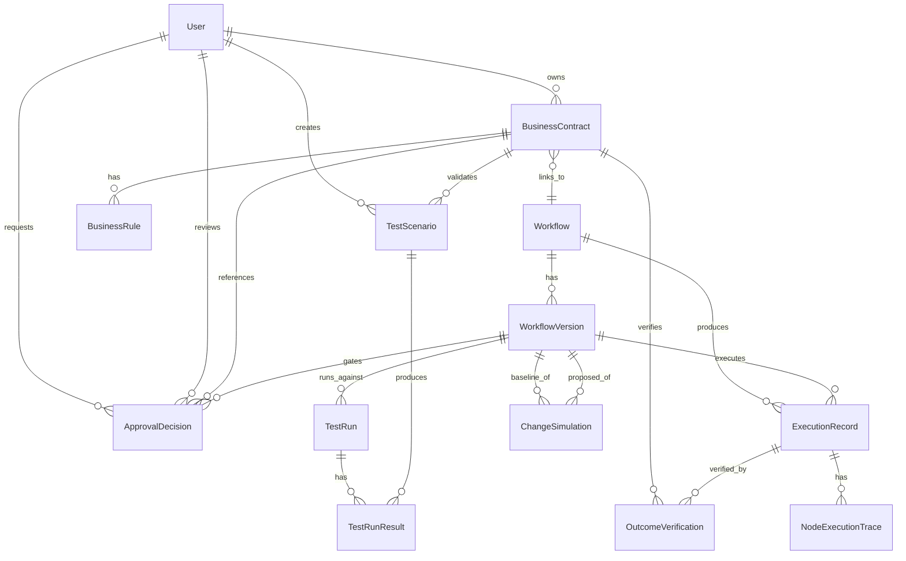

# Architecture Overview, Data Model & API Specification

## System Architecture

```
┌─────────────────────────────┐        ┌──────────────────────────────┐
│  client (Vite + React + TS)  │  HTTP  │  server (Express + TS)        │
│  - React Router pages        │◄──────►│  - routes/*  (REST handlers)   │
│  - Zustand (UI state only)   │  /api  │  - services/ruleEngine.ts      │
│  - React Flow canvas         │        │  - services/workflowInterpreter│
│  - Tailwind v4 + shadcn-style│        │  - Prisma ORM                  │
└───────────────────────────────┘        └──────────────┬─────────────────┘
                                                          │
                                                   ┌──────▼──────┐
                                                   │   SQLite     │
                                                   │   (dev.db)   │
                                                   └──────────────┘
```

No message queue, no microservices, no real third-party connectors — intentionally, per the project's scope guardrails. All "external" calls in `mockApiAction` nodes are simulated in-process by the interpreter.

## Entity-Relationship Diagram



See `server/prisma/schema.prisma` for the authoritative field-level definition.

## API Specification (by router)

All endpoints are under `/api`. Full request/response shapes are in the route source files; this is the index.

| Router | Key endpoints |
|---|---|
| `dashboard` | `GET /dashboard` (live KPIs), `GET /dashboard/execution-trends`, `GET /dashboard/failure-categories` |
| `contracts` | `GET/POST /contracts`, `GET/PATCH /contracts/:id`, `POST /contracts/:id/transition`, `POST /contracts/:id/duplicate` |
| `workflows` | `GET/POST /workflows`, `GET /workflows/:id`, `POST /workflows/:id/versions`, `PATCH /workflows/:id/versions/:versionId`, `POST .../validate`, `POST .../test` (side-effect-free), `POST /workflows/:id/publish` |
| `workflow-templates` | `GET /workflow-templates` — the 5-industry example library |
| `scenarios` | `GET/POST /scenarios`, `PATCH/DELETE /scenarios/:id`, `POST /scenarios/run-suite` (rule engine + real graph trace) |
| `outcomes` | `GET /outcomes`, `GET /outcomes/:id`, `POST /outcomes/:id/reverify`, `PATCH /outcomes/:id/resolution` |
| `executions` | `GET /executions`, `GET /executions/:id` (node-by-node trace) |
| `simulations` | `GET /simulations`, `GET /simulations/:id` (Change Impact Lab data) |
| `approvals` | `GET/POST /approvals`, `POST /approvals/:id/decide` |
| `analytics` | `GET /analytics/by-domain`, `/contract-status`, `/outcome-status`, `/approval-funnel`, `/scenario-coverage` |
| `users` | `GET /users` |

## Why SQLite + Prisma + Express (and not more)

This is explicitly a portfolio/demo artifact, not a production release — see the spec's own instruction: "Do not overengineer the backend." SQLite removes any external dependency to run the project; Prisma keeps the schema declarative and typed; Express keeps routing boring and readable. Horizontal scale, queues, and real auth are deliberately out of scope (see `05-traceability-and-roadmap.md`).
